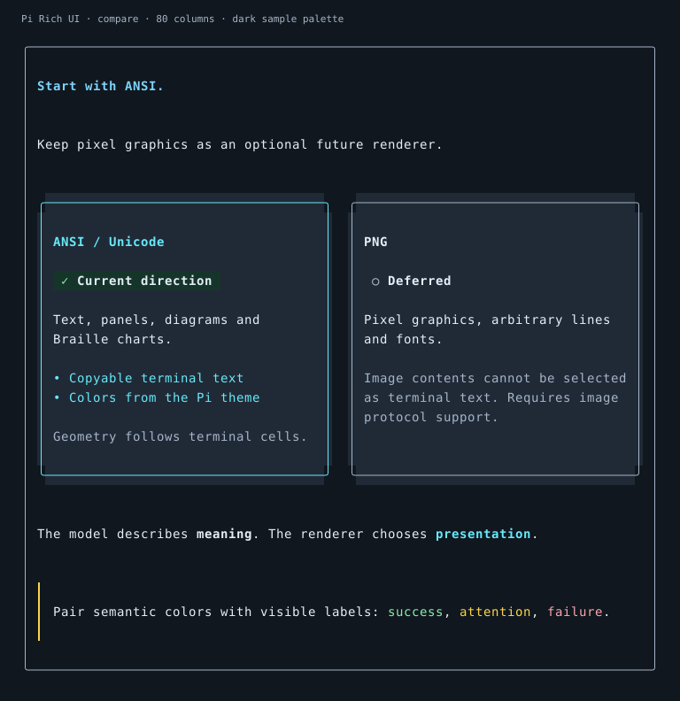
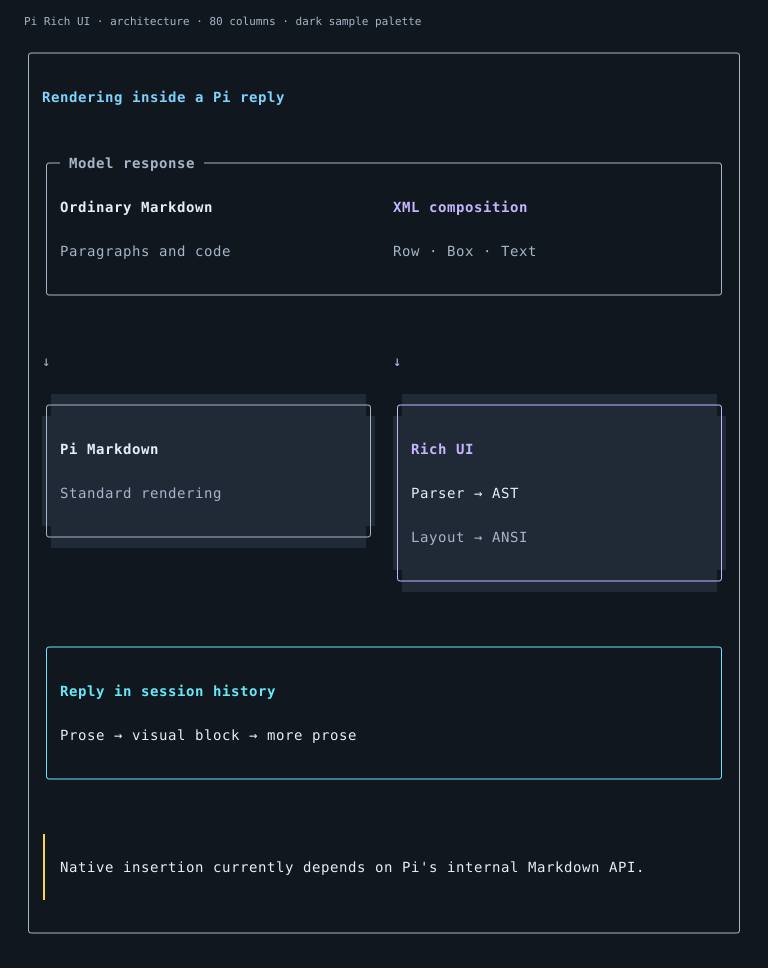
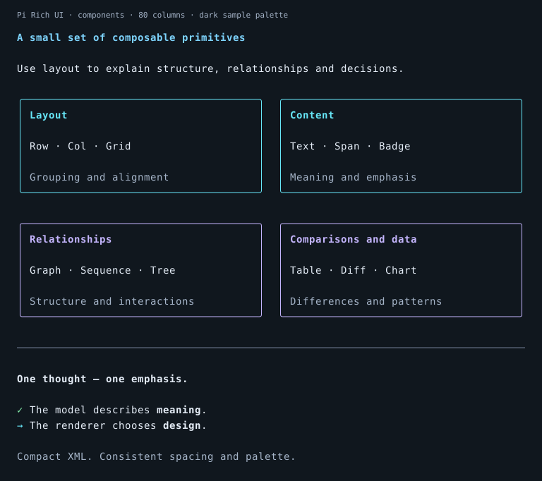
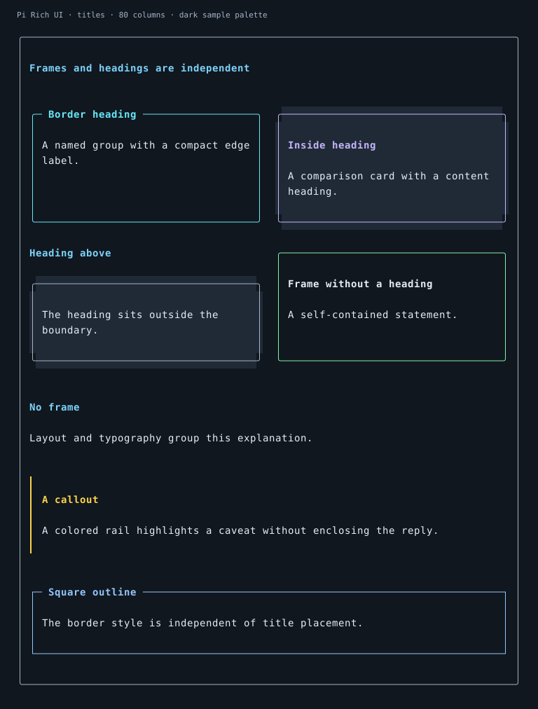
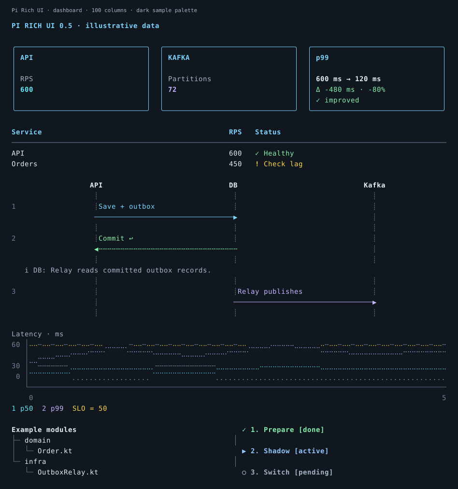

# Pi Rich UI

[](https://github.com/AnatoliyYakimov/pi-rich-ui/actions/workflows/ci.yml)
[](LICENSE)

**Colorful inline explanations for your Pi terminal.**

Compose panels, comparisons, diagrams, trees, timelines and Braille charts using
compact, React-inspired XML. Everything stays inside the conversation, with semantic
colors from your Pi theme and layouts that adapt to terminal width.



*Actual output of the cell renderer, exported for documentation with a sample palette.
These are not browser UI mockups or screenshots of a running Pi. Your theme and font
choose the final shades and glyphs. The extension itself renders ANSI text, not images.*

[Install](#installation) · [Examples](#visual-examples) · [Reference](docs/REFERENCE.md) · [Gallery](docs/GALLERY.md)

## What it adds

- **General visual explanations:** compare options, group ideas and highlight caveats.
- **Architecture:** flows, sequence diagrams, dependency graphs and module trees.
- **Data:** rich tables, numeric/text diffs, Braille plots, thresholds and mini-bars.
- **A coherent terminal design:** colorful outlines, bold headings, muted captions,
  inline emphasis and rails for callouts. The terminal background stays untouched.
- **Independent headings and borders:** put a heading inside a card, above it, on its
  border, or omit it. A frame is optional, not a requirement for visual content.

Model guidance is injected automatically. No extra tool call is needed to draw a block.
This is static rich text, not a React runtime or an interactive dashboard application.

## Installation

### Requirements

- Pi coding agent with `registerMarkdownTransformer()`.
- Node.js **22.19.0 or newer**.
- Git and a Unicode terminal. Braille charts require a font with Braille glyphs.

### npm package

After the first npm release is published:

```bash
pi install npm:pi-rich-ui-inline
```

Restart Pi or run `/reload`. Update with `pi update npm:pi-rich-ui-inline`.
For a pinned installation, use `pi install npm:pi-rich-ui-inline@0.5.2`.

### Git installation

Pi can manage a Git installation directly (available before the first npm release):

```bash
pi install git:github.com/AnatoliyYakimov/pi-rich-ui
```

Alternatively, clone into the extensions directory manually:

```bash
mkdir -p ~/.pi/agent/extensions
git clone https://github.com/AnatoliyYakimov/pi-rich-ui.git \
  ~/.pi/agent/extensions/pi-rich-ui
```

No `npm install` or build step is required; Pi supplies its host modules.
Start Pi or run `/reload`, then:

```text
/rich-ui status
/rich-ui demo
```

The local demo uses no LLM request. Do not load the same extension twice through both
the extensions directory and `pi -e`.

For a temporary trial:

```bash
git clone https://github.com/AnatoliyYakimov/pi-rich-ui.git
cd pi-rich-ui
pi -e ./index.ts
```

To update a Git installation, run `git pull --ff-only` in its directory and `/reload` in Pi.

**Compatibility:** native inline output uses a guarded runtime adapter around Pi's
internal `Markdown.renderToken`, not a stable public component hook. An incompatible
host falls back to plain fenced text. The real Markdown integration is smoke-tested
against **official `pi-tui` 1.5.0**; see [validation](#development-and-validation) and
[integration details](docs/INTEGRATION.md).

## First conversation

Ask Pi:

> Explain why we chose ANSI over PNG using two comparison cards and a caveat.
> Then show how XML becomes a visual block inside an ordinary assistant response.

The extension guides the model to use a compact visual whenever it improves clarity,
understanding or retention, replacing long lists and winding explanations with a small
composition and brief supporting prose. The instruction is English; output labels
follow your language. Simple facts may remain plain Markdown.

The injected core is 1,646 characters: short rules, a compact element reference and
three purpose-labeled examples. Advanced attributes stay in a local reference, read
only when needed; its absolute installed path is included, not its contents.

The extension adds this guide to the model's system prompt. Visual blocks
appear on their own lines **outside code fences** in assistant replies. Fenced XML,
including this documentation example, remains literal code:

```xml
<Grid cols={2}>
  <Card title="ANSI" tone="cyan">
    <Badge tone="success">Current choice</Badge>
    <Text>Copyable text, diagrams and Braille charts.</Text>
  </Card>
  <Card title="PNG" borderTone="muted" titleTone="text">
    <Caption>Deferred until pixel graphics are needed.</Caption>
  </Card>
</Grid>
```

## Visual examples

### Explain architecture



Nodes, prose, captions and caveats can share one composition. Ordinary response text
continues around the block. Try `/rich-ui architecture`.

### Group concepts



Headings are part of the card content here; they do not cut into the outline.
The concluding emphasis has no frame. Try `/rich-ui components`.

### Choose heading placement



```xml
<UI>
<Box title="Compact group" titlePosition="border">...</Box>
<Card title="Comparison" titlePosition="inside">...</Card>
<Card title="Independent heading" titlePosition="above">...</Card>
<Box><Text>A statement that needs no heading.</Text></Box>
<Box border={false} padding={0}><Text>Unframed explanation.</Text></Box>
<Callout tone="warning"><Text>A caveat without a full outline.</Text></Callout>
</UI>
```

`Card` defaults to an inside heading; `Box` defaults to a border heading.
`titlePosition="none"` deliberately suppresses a supplied title. Long border titles
wrap above the frame instead of being cut off. Use `borderTone` and `titleTone` to
style those parts independently of the body. Try `/rich-ui titles`.

### Charts and engineering data



Tables, metrics, status labels and multiple Braille series retain their existing data
semantics. The dashboard is one possible composition; the same primitives also work
for explanations without numbers. Try `/rich-ui dashboard`.

[Full XML and narrow-width gallery](docs/GALLERY.md) · [Light theme preview](docs/previews/compare-80-light.svg) · [40-column preview](docs/previews/compare-40-dark.svg)

## Explore locally

| Command | Shows |
| --- | --- |
| `/rich-ui demo` or `/rich-ui compare` | ANSI vs PNG comparison |
| `/rich-ui architecture` | Rendering inside a Pi response |
| `/rich-ui components` | Layout, content, relationships and data primitives |
| `/rich-ui titles` | Independent heading/border combinations |
| `/rich-ui dashboard` | Illustrative engineering dashboard |
| `/rich-ui table`, `/rich-ui diff` | Rich cells, thresholds and before/after views |
| `/rich-ui sequence`, `/rich-ui tree` | Interaction sequences and hierarchies |
| `/rich-ui timeline`, `/rich-ui layout` | Stages, responsive grids and spanning cells |
| `/rich-ui charts`, `/rich-ui palette` | Braille plots and semantic colors |
| `/rich-ui status`, `/rich-ui prompt` | Active renderer mode and exact model instruction |

Demo commands create display-only session entries, not model requests.

## Configuration

```bash
NO_COLOR=1 pi                 # No color/bold; keep Unicode and Braille
PI_RICH_UI_RENDER=text pi     # Public-hook text fallback; no native adapter
PI_RICH_UI_PROMPT=0 pi        # Disable automatic model guidance
```

Colors follow **Pi's active theme**. Aliases include green → success, red → error,
yellow → warning and blue → info. Color is paired with status symbols or labels.
No external icon font is required. [Full configuration](docs/REFERENCE.md#configuration).

## Scope and limitations

- Static inline visuals; no mouse/focus handling, sliders, or clickable tree expansion.
- ANSI/Unicode runtime; no PNG, SVG, browser rendering or generated code execution.
- Original XML stays in history. A client without the extension sees that XML.
- Bounded size/depth/layout, with explicit truncation notices for oversized content.
- Explanations are not live telemetry unless the model has actually retrieved that data.

The parser does not evaluate JavaScript or fetch resources. XML cannot access your
shell, network or files. The extension itself runs with Pi's normal permissions.
[Detailed limits and security](docs/REFERENCE.md#prompt-history-and-security).

## Development and validation

```bash
npm test
npm run check
npm run test:package
npm run preview -- --file examples/compare.xml --width 80 --colors truecolor
npm run preview:assets
npm run test:host -- /path/to/pi-tui/dist/index.js
```

The local suite has **332 tests**, including width sweeps from 1–160 columns and
**39 golden snapshots**. The actual `pi-tui` 1.5.0 smoke test renders 13 compositions,
checks resizing at 24/40/80/120 columns and preserves literal fenced XML. Local host
mocks remain useful for lifecycle tests. An offline interactive Pi 1.5.0 PTY trial also loaded the extension and displayed
its local commands in regular and fullscreen modes, including theme colors and
NO_COLOR. No LLM request was made. Physical terminal/font combinations remain separate checks.
See the [TUI smoke record](docs/TUI-SMOKE.txt).

`preview:assets` exports actual terminal cells into static SVG documentation previews;
it is not an image renderer loaded by the extension and needs no image library.

CI runs syntax checks, tests and npm archive checks on Node 22.19, 24 and 26.
A separate job tests Pi 1.5.0 and loads the packed `index.ts` through Pi's extension
loader. Host modules are peer dependencies supplied by Pi, never bundled copies.

Tags such as `v0.5.2` trigger the same checks, npm publishing through OIDC, and a
GitHub Release. See [release setup and instructions](docs/RELEASING.md).

## License

Copyright 2026 Anatoliy Yakimov. Licensed under the [Apache License 2.0](LICENSE).

[Component reference](docs/REFERENCE.md) · [Gallery](docs/GALLERY.md) · [Integration](docs/INTEGRATION.md) · [Changelog](CHANGELOG.md)
