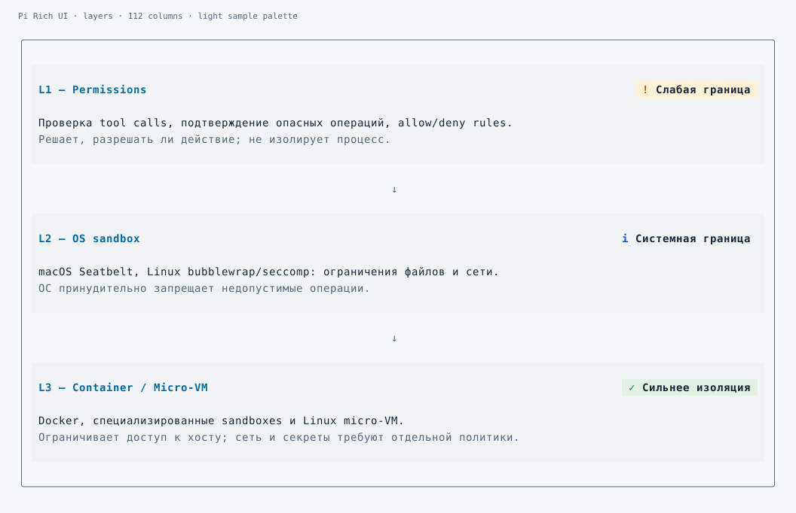
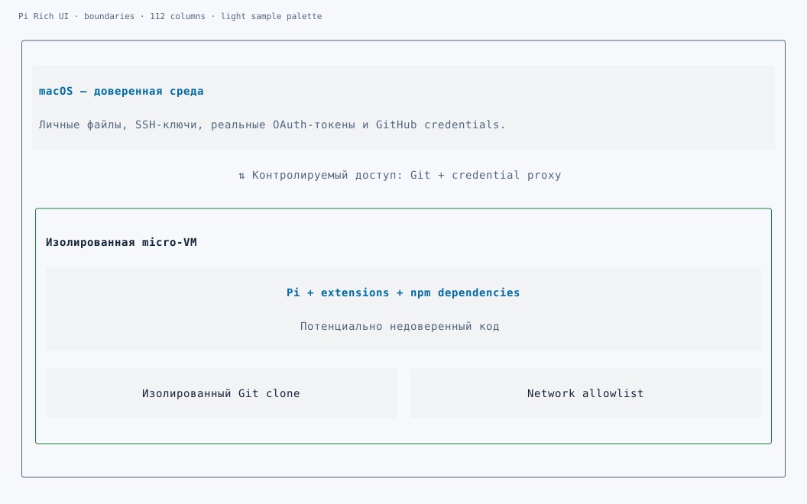
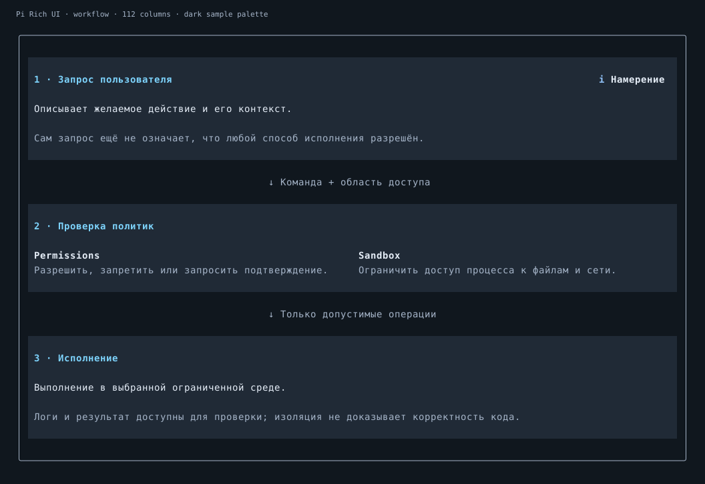
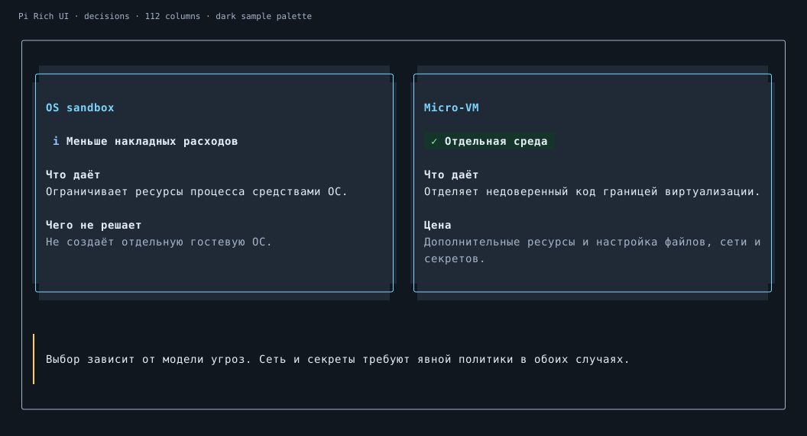

# Pi Rich UI — explanatory compositions

These previews export **actual terminal cells**, including themed surfaces, into SVG
for documentation. Runtime output is ANSI/Unicode, not a browser screenshot or image.
Labels in the recipes are illustrative explanations, not a security audit of your
machine. Pi uses its active theme; colors and glyphs vary by terminal and font.

[Install](../README.md) · [Component reference](REFERENCE.md)

## 1. Explain layers, not just numbers



[Dark version](previews/layers-112-dark.svg) · [Complete XML](../examples/layers.xml)

`/rich-ui demo` and `/rich-ui layers` show cards with a title/status header, main text,
a muted explanation and arrows between layers. The enclosing UI supplies the outer
contour; inner cards deliberately keep surfaces and omit redundant outlines.

```xml
<UI gap={1}>
  <Card border={false}>
    <Row>
      <Title flex={1}>Permissions</Title>
      <Badge tone="warning" flex={0}>Approval boundary</Badge>
    </Row>
    <Col gap={0}>
      <Text>Checks whether a requested action is allowed.</Text>
      <Caption>Does not isolate the process.</Caption>
    </Col>
  </Card>
  <Connector/>
  <Card border={false}>
    <Row>
      <Title flex={1}>OS sandbox</Title>
      <Badge tone="info" flex={0}>Enforced boundary</Badge>
    </Row>
    <Text>Restricts filesystem, process and network access.</Text>
    <Caption>The concrete policy determines the allowed resources.</Caption>
  </Card>
</UI>
```

A narrow window moves a status below its heading instead of deleting it. A wide
window does not force ordinary text past the readable 112-cell measure.

## 2. Explain a nested boundary



[Dark version](previews/boundaries-112-dark.svg) · [40-cell view](previews/boundaries-40-dark.svg) · [Complete XML](../examples/boundaries.xml)

`/rich-ui boundaries` shows the important distinction between a **relationship** and
**containment**: controlled access lies between the outer host and the boundary;
the agent, isolated clone and network policy are inside that boundary.

```xml
<UI gap={1}>
  <Card border={false}>
    <Title>Trusted host</Title>
    <Caption>Personal files, SSH keys and real credentials.</Caption>
  </Card>
  <Connector direction="both" label="Controlled access: Git + credential proxy"/>
  <Box title="Isolated environment" titlePosition="inside"
       borderTone="success" titleTone="text" surface="none">
    <Card border={false}>
      <Title align="center">Agent + extensions + dependencies</Title>
      <Caption align="center">Potentially untrusted code</Caption>
    </Card>
    <Grid cols={2} minWidth={22}>
      <Card border={false}><Text align="center">Isolated clone</Text></Card>
      <Card border={false}><Text align="center">Network policy</Text></Card>
    </Grid>
  </Box>
</UI>
```

The two lower cards stack when needed. There is no graph-engine guess about which
node belongs to which boundary: containment follows explicit XML nesting.

## 3. Explain a workflow



`/rich-ui workflow` · [Complete XML](../examples/workflow.xml)

Describe request → policy checks → execution. Put related participants/checks inside
a card; label transitions with the information or condition they carry. Use
`Connector direction="up"` or `"both"` for the relationship actually being explained.
For message-by-message exchanges, [Sequence](../examples/sequence.xml) is more precise.
Do not invent latency or throughput to make an explanation look like a dashboard.

## 4. Compare decisions and state a conclusion



`/rich-ui decisions` · [Complete XML](../examples/decisions.xml)

Grid intentionally gives equal tracks to alternatives. Card headings, benefits and
limitations form compact groups; a Callout below carries the shared caveat. Use Row
instead when differently sized groups should stay content-oriented rather than equal.

## Control the visual emphasis

- `border={false}` removes the outline, **not** the surface.
- `surface="none"` reveals the parent, **not** necessarily the terminal default.
- `surface="success|warning|error|info|subtle"` chooses a semantic surface.
- `borderTone` highlights a meaningful boundary independently of body or background.
- `padding={0}` / `density="compact"` reduces fields; `gap` controls group spacing.
- `Text/Title/Caption align="center"` centers each wrapped line.
- Root `width="full"` opts into a deliberately wide diagram; nested blocks cannot
  escape their parent's budget. `maxWidth` works without an extra Row wrapper.

Plain Markdown can continue before and after a composition. Frames are not forced
around every sentence. NO_COLOR keeps labels, relationships and explicit contours;
explicitly frame-free cards are separated by their headings/fields instead of color.

## Other supported compositions

These remain available, but are secondary to general visual explanations:

| Command | XML recipe | Purpose |
| --- | --- | --- |
| `/rich-ui compare` | [compare.xml](../examples/compare.xml) | ANSI vs PNG decision |
| `/rich-ui architecture` | [architecture.xml](../examples/architecture.xml) | Rendering pipeline |
| `/rich-ui components` | [components.xml](../examples/components.xml) | Component families |
| `/rich-ui titles` | [titles.xml](../examples/titles.xml) | Heading/border combinations |
| `/rich-ui sequence` | [sequence.xml](../examples/sequence.xml) | Interactions and return messages |
| `/rich-ui tree` | [tree.xml](../examples/tree.xml) | Hierarchies |
| `/rich-ui timeline` | [timeline.xml](../examples/timeline.xml) | Stages and statuses |
| `/rich-ui layout` | [layout.xml](../examples/layout.xml) | Responsive tracks and spans |
| `/rich-ui table` | [table.xml](../examples/table.xml) | Rich cells and thresholds |
| `/rich-ui diff` | [diff.xml](../examples/diff.xml) | Numeric/text changes |
| `/rich-ui charts` | [charts-v04.xml](../examples/charts-v04.xml) | Actual numeric trends |
| `/rich-ui dashboard` | [dashboard.xml](../examples/dashboard.xml) | Illustrative engineering metrics |
| `/rich-ui palette` | [palette.xml](../examples/palette.xml) | Semantic colors |

Run `npm run preview -- --file examples/boundaries.xml --width 112 --colors truecolor`
for ANSI output, or add `--plain` for a monochrome structural view. `npm run preview:assets`
regenerates the SVG cell exports. Physical terminal/font validation remains separate.
